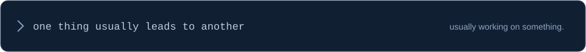

<!-- JESSY.EXE: install this file and the assets folder together at the root of jesss77/jesss77. -->

**MSc Computer Science student @ AUB**

*Somewhere between a good idea and another coffee.*

[GitHub](https://github.com/jesss77) &nbsp; / &nbsp; [LinkedIn](https://www.linkedin.com/in/jessy-karamaoun) &nbsp; / &nbsp; [Email](mailto:jessykaramaoun1@gmail.com)

 

### `01` &nbsp; A little about me

I like building things that are useful, interesting, or just fun to make.

My work spans software development, AI, and data, with the occasional detour into game development. I've worked on full-stack applications and machine learning pipelines. One idea tends to turn into another project.

**The usual mix:** `Software Engineering` · `AI & Machine Learning` · `Data Engineering` · `Game Development`

 

### `02` &nbsp; My toolkit

| Where I use it | What I work with |
| :--- | :--- |
| **Languages** | Python · JavaScript · TypeScript · C# · C++ · Kotlin · SQL |
| **Web & backend** | React · Node.js · ASP.NET Core |
| **Data & AI** | Power BI · SQL Server · Vector embeddings · LLMs |
| **Android** | Kotlin · MVVM · Room |
| **Games & everyday tools** | Godot · Git |

 

### `03` &nbsp; Selected projects

<table>
<tr>
<td width="50%" valign="top">

#### Driving Test Practice

Interactive practice for the Lebanese driving test.

HTML · CSS · JavaScript

**[Try it →](https://jesss77.github.io/driving-test-practice/)**

</td>
<td width="50%" valign="top">

#### Match & Learn

An educational matching game for early childhood learning.

React · JavaScript · Kodular

**[Play & learn →](https://match-and-learn.vercel.app)**

</td>
</tr>
</table>

| Project | What I built | Toolkit |
| :--- | :--- | :--- |
| **RAG Agent** | Document retrieval and LLM-powered question answering | Python · Vector embeddings · LLMs |
| **Restaurant Booking System** | A full-stack reservation platform with real-time availability and role-based dashboards | ASP.NET Core · SQL Server |
| **Smart Expense Tracker** | An Android finance tracker with budget alerts, analytics, and PDF export | Kotlin · MVVM · Room |

 

