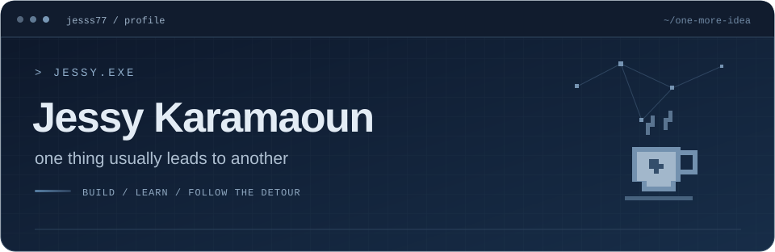

<!-- JESSY.EXE: install this file and the assets folder together at the root of jesss77/jesss77. -->

**MSc Computer Science student @ AUB**

*Somewhere between a good idea and another coffee.*

[LinkedIn](https://www.linkedin.com/in/jessy-karamaoun) &nbsp; / &nbsp; [Email](mailto:jessykaramaoun1@gmail.com)

 

### `01` &nbsp; A little about me

I like building things that are useful, interesting, or just fun to make.

My work spans software development, AI, data, and game development. I've worked on full-stack applications and machine learning pipelines. One idea tends to turn into yet another project.

`Software Engineering` · `AI & Machine Learning` · `Data Engineering` · `Game Development`

 

### `02` &nbsp; My toolkit

| Category | Technologies |
| :--- | :--- |
| **Languages** | Python · JavaScript · TypeScript · C# · C++ · Kotlin · SQL |
| **Web & backend** | React · Node.js · ASP.NET Core |
| **Data & AI** | Power BI · SQL Server · Vector embeddings · LLMs |
| **Android** | Kotlin · MVVM · Room |
| **Games** | Godot · Git |

 

### Projects

#### Driving Test Practice

Practice questions for the Lebanese driving test.

HTML · CSS · JavaScript

**[Try it →](https://jesss77.github.io/driving-test-practice/)**

| Project | What it does | Stack |
| :--- | :--- | :--- |
| **RAG Agent** | Finds relevant content in documents and uses an LLM to answer questions about it. | Python · Vector embeddings · LLMs |
| **Restaurant Booking System** | Handles reservations, tracks availability in real time, and provides dashboards for different user roles. | ASP.NET Core · SQL Server |
| **Smart Expense Tracker** | Tracks expenses on Android, sends budget alerts, shows spending analytics, and exports PDF reports. | Kotlin · MVVM · Room |
